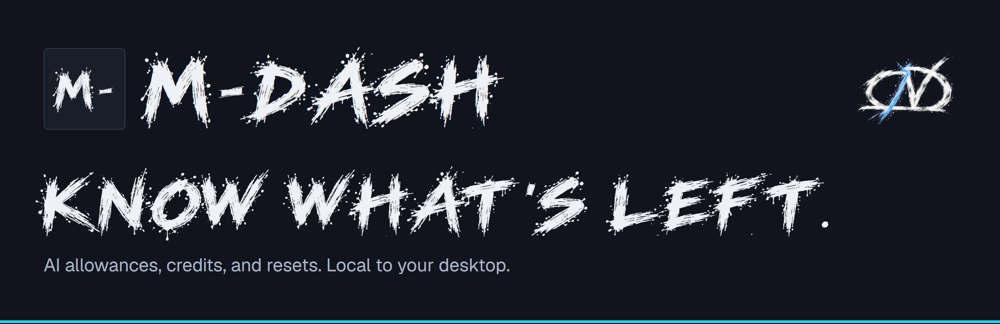

<p align="center">
  
</p>

A local desktop dashboard for your AI accounts. See allowances, reset times,
credits, and usage history for any combination of **Codex, Claude, Grok, and
OpenRouter**. Minimize it to a compact strip, or check the allowance bars in your
Windows tray or Mac menu bar.

m-dash runs entirely on your computer. There is no m-dash account, hosted
dashboard, or analytics.

## What it does

- Shows provider-reported capacity and clearly labels missing or stale readings.
- Keeps local history and estimates exhaustion only with enough recent data.
- Lets you choose providers and up to four compact allowance windows.
- Optionally, when your Claude five-hour window has expired, sends a small `ping`
  to start the next one. It is off by default and uses a little of your Claude
  usage.
- Keeps subscription sign-in in the provider's CLI. OpenRouter keys use Windows
  Credential Manager, macOS Keychain, or the Linux Secret Service.

| Provider | Measurements | Connection |
| --- | --- | --- |
| Codex | Reported allowances, resets, credits and token history | Signed-in Codex CLI |
| Claude | Account allowances and optional local token history | Signed-in native Claude Code CLI; usage contract is experimental |
| Grok | Reported allowance, prepaid balance and usage-period end | Signed-in Grok CLI; token history is unavailable |
| OpenRouter | Credit balance and completed-day token imports | Your management key; current UTC-day totals are unavailable |

Different units and accounts stay separate. Disabling a provider preserves its
history and connections. Closing the window keeps collection running; use
**Quit m-dash** in the tray/menu bar to exit.

Account collection does not send model prompts. **Optional Claude ping is off by
default** and requires a separate usage confirmation: it sends a fixed `ping`
through Claude Code and consumes subscription allowance, potentially paid extra
usage. See the [user guide](docs/USER_GUIDE.md#optional-claude-ping).

## Download

Installers are published on the
[Releases page](https://github.com/chuck-quypto/m-dash/releases).

| Platform | Package | Notes |
| --- | --- | --- |
| Windows x64 | Per-user NSIS setup `.exe` | Not Authenticode-signed; Windows SmartScreen may warn on first run |
| macOS 12+ on Apple Silicon | Developer ID signed, notarized `.dmg` | Intel and universal builds are not provided |
| Linux | Build from source | Ubuntu x86_64 works in development; not yet a supported release |

Each release lists SHA-256 checksums and GitHub build attestations. See
[verifying a download](RELEASING.md#verify-a-download). Never bypass Gatekeeper
or Windows security settings for a file you have not verified.

Installed builds need no Node.js, Rust, database server, or paid m-dash account.
The [user guide](docs/USER_GUIDE.md) covers provider sign-in, the tray and compact
strip, upgrades, backups and removal. Collection runs only while m-dash is running;
automatic startup and automatic updates are not included.

Read [privacy and storage](docs/PRIVACY.md) before connecting accounts. Usage history
contains account identifiers and measurements; keep databases, credentials,
pairing codes, and personal screenshots out of issue reports.

## Build from source

Use Node.js 24+, npm, stable Rust, and the
[Tauri platform prerequisites](https://v2.tauri.app/start/prerequisites/).

```sh
npm ci
npm run tauri -- dev
```

Windows x64, from PowerShell with MSVC C++ build tools installed:

```powershell
npm run tauri -- build --target x86_64-pc-windows-msvc --bundles nsis
```

macOS Apple Silicon, on a Mac with Xcode command-line tools:

```sh
npm run tauri -- build --config src-tauri/tauri.macos.conf.json --target aarch64-apple-darwin --bundles app,dmg
```

Local builds are unsigned unless you supply your own signing configuration. See
[development and packaging](docs/DEVELOPMENT.md) for Linux, tests, synthetic
previews and notices, and [architecture](docs/ARCHITECTURE.md) for how the pieces fit.

## Documentation

- [User guide](docs/USER_GUIDE.md): install, connect providers, tray, upgrades
- [Providers](docs/PROVIDERS.md): how each provider is read and what can break
- [Privacy and storage](docs/PRIVACY.md): what is stored and what leaves your computer
- [Architecture](docs/ARCHITECTURE.md) and [development](docs/DEVELOPMENT.md)
- [Releasing and verification](RELEASING.md) and the [changelog](CHANGELOG.md)

The Android companion, encrypted sync and relay in `mobile/`, `sync-core/` and
`relay/` are experimental development code. They are not part of the desktop
release and no hosted relay is provided.

## Contribute and report problems

Start with [CONTRIBUTING.md](CONTRIBUTING.md). Bugs and provider breakage belong in
[GitHub Issues](https://github.com/chuck-quypto/m-dash/issues); include app, OS and
CLI versions and a redacted reproduction. Report vulnerabilities privately using
[SECURITY.md](SECURITY.md). Everyone taking part follows the
[code of conduct](CODE_OF_CONDUCT.md).

## License and attribution

Application code and documentation are licensed under [Apache 2.0](LICENSE).
CND artwork and CND Hybrid Display have [separate redistribution permission](BRAND-LICENSE.txt);
third-party software and companion fonts retain their own licenses. See
[license scope](docs/LICENSING.md), [trademarks](TRADEMARKS.md),
[notices](THIRD-PARTY-NOTICES.txt), and [licenses/](licenses/).

m-dash is an unofficial tool. It is independent of OpenAI, Anthropic, xAI, and
OpenRouter and is not endorsed by those providers. Provider names identify
compatible services only.
